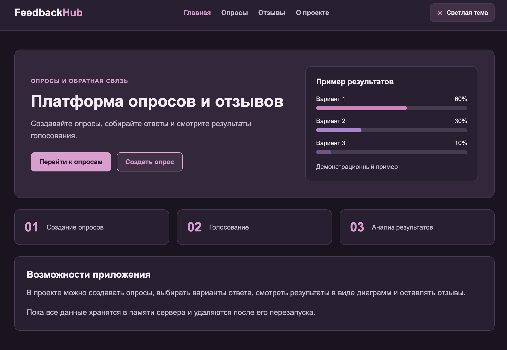
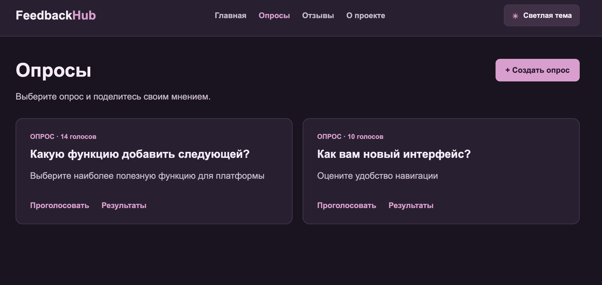
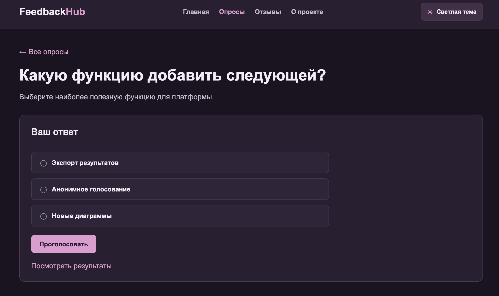
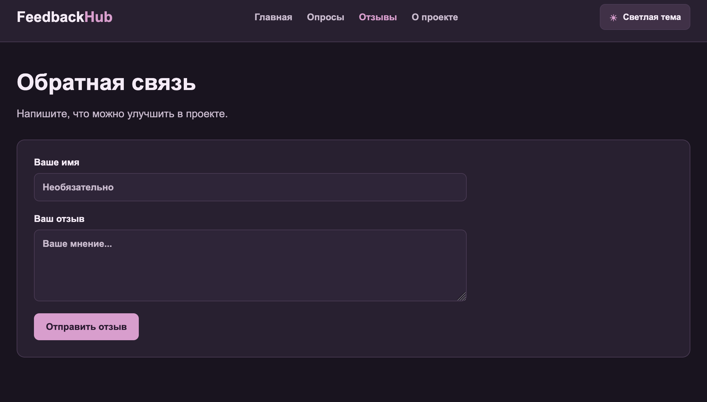

# Платформа для сбора отзывов и голосований

Учебный курсовой проект на тему «Разработка платформы для сбора отзывов и голосований с аналитикой результатов с использованием Node.js».

## Возможности MVP

Главный сценарий — пользователь выбирает опрос, голосует и видит обновлённую статистику.

- Просмотр списка опросов и вариантов ответа
- Голосование за один вариант
- Просмотр количества голосов, процентов и диаграмм
- Сообщения об ошибках при отсутствии выбора или недоступном API
- Создание новых опросов и отправка отзывов
- Переключение светлой и тёмной темы

## Технологии и структура

Используются Node.js 22.12+, React 19.3.1, TypeScript, Express, React Router, Vite, Vitest и ESLint.

- `frontend/` — интерфейс React и маршруты
- `ui-library/` — общие React-компоненты и юнит-тесты
- `backend/` — API Node.js, обработка голосов и статистика
- `architecture.md` — архитектура и зависимости
- `mvp.md` — границы MVP и пользовательские сценарии

## Запуск

Из корня проекта выполните:

```bash
npm install
npm run dev
```

Приложение: http://localhost:5173

Проверка API: http://localhost:3001/api/health

Остановка серверов — `Ctrl+C`.

Данные хранятся в оперативной памяти сервера и сбрасываются после перезапуска backend.

## Как проверить основной сценарий UC-01

1. Откройте http://localhost:5173/surveys.
2. Нажмите «Проголосовать» у любого опроса.
3. Выберите вариант ответа.
4. Нажмите кнопку «Проголосовать».
5. После отправки откроется страница результатов.
6. Проверьте, что число голосов увеличилось на один, а проценты и диаграммы обновились.

Дополнительно можно проверить отправку формы без выбора ответа (появится ошибка), а также открыть несуществующий опрос по адресу `/surveys/missing`.

## Команды проверки

Из корня проекта:

```bash
npm run build
npm run lint
npm run test
npm run test:coverage
```

Отдельно для UI-библиотеки:

```bash
npm run test:coverage -w @feedback/ui
```

Для компонента `Button` настроен минимальный порог покрытия 90% по statements, branches, functions и lines. В лабораторной № 5 фактическое покрытие составляло 100% по всем четырём метрикам.

## Скриншоты

### Главная страница


### Список опросов — начало основного сценария


### Выбор варианта ответа


### Результаты после отправки голоса


### Форма обратной связи


## Ограничения

Это учебный MVP: пока нет авторизации, постоянной базы данных и защиты от повторного голосования. Голоса и отзывы сохраняются только до перезапуска API.

## Сдача лабораторной № 6

Работа выполняется в ветке `lab6` курсового репозитория. Создаётся Pull Request `lab6` → `main`.

В репозитории заданий `js_6310_labs_2026` сдаётся только файл `lab6-mvp/solutions/student-27/solution.md` со ссылкой на этот Pull Request. Для него создаётся PR `student-27-lab6` → `main` с названием `Lab6 solution by student27`.
