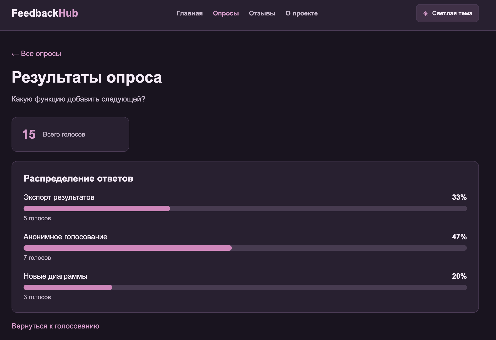

# Платформа для сбора отзывов и голосований

Учебный проект по теме «Разработка платформы для сбора отзывов и голосований с аналитикой результатов с использованием Node.js».

## Возможности

- Просмотр и создание опросов
- Голосование за один вариант ответа
- Просмотр результатов голосования
- Аналитика: проценты и горизонтальные диаграммы
- Отправка текстовых отзывов
- Переключение светлой и тёмной темы
- Навигация между страницами через React Router
- Общая библиотека UI-компонентов с тестами

## Технологии

- Node.js 22.12+
- React 19.3.1
- TypeScript
- Express
- React Router
- Vite
- Vitest
- ESLint

## Структура проекта

Проект состоит из трёх частей:

- `frontend` — клиентское приложение на React и TypeScript
- `backend` — сервер на Node.js и Express
- `ui-library` — библиотека переиспользуемых компонентов

Дополнительные файлы:

- `architecture.md` — описание архитектуры проекта
- `mvp.md` — функциональные требования к MVP
- `README.md` — описание и инструкция по запуску

## Запуск

Для работы требуется Node.js версии 22.12 или выше и npm.

1. Установить зависимости:

```bash
npm install
```

2. Запустить приложение:

```bash
npm run dev
```

3. Открыть приложение в браузере:

http://localhost:5173

Сервер API запускается на адресе:

http://localhost:3001

Проверка работы API:

http://localhost:3001/api/health

Все команды выполняются из корневой папки проекта.

Для остановки приложения используется `Ctrl+C`.

Данные хранятся в оперативной памяти сервера и сбрасываются после его перезапуска.

## Проверка проекта

Сборка:

```bash
npm run build
```

Проверка ESLint:

```bash
npm run lint
```

Запуск тестов:

```bash
npm run test
```

Проверка покрытия тестами:

```bash
npm run test:coverage
```

Для проверки отдельного проекта можно использовать npm workspaces.

Например, проверка UI-библиотеки:

```bash
npm run lint -w @feedback/ui
npm run test -w @feedback/ui
npm run test:coverage -w @feedback/ui
```

Покрытие тестами компонента Button составляет 100% по всем показателям.

## Скриншоты приложения

### Главная страница


### Список опросов


### Голосование


### Результаты голосования



### Обратная связь


## Ограничения

Проект представляет собой каркас курсового приложения для лабораторной работы № 5.

На данный момент не реализованы:

- Регистрация и авторизация пользователей
- Постоянное хранение данных в базе данных
- Защита от повторного голосования

Эти возможности планируется добавить при дальнейшем развитии курсового проекта.

## Сдача лабораторной работы

Разработка ведётся в отдельном публичном репозитории GitHub в ветке `lab5`.

Для проверки создаётся Pull Request из ветки `lab5` в `main`.

В репозитории `js_6310_labs_2026` создаётся ветка `student-27-lab5`.

В неё добавляется файл:

`solutions/student-27/solution.md`

Файл содержит ссылку на Pull Request курсового проекта.
